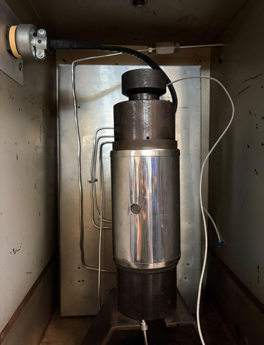
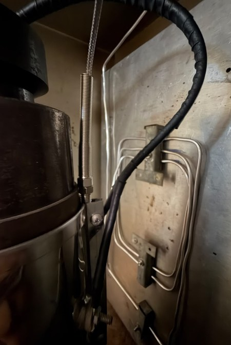
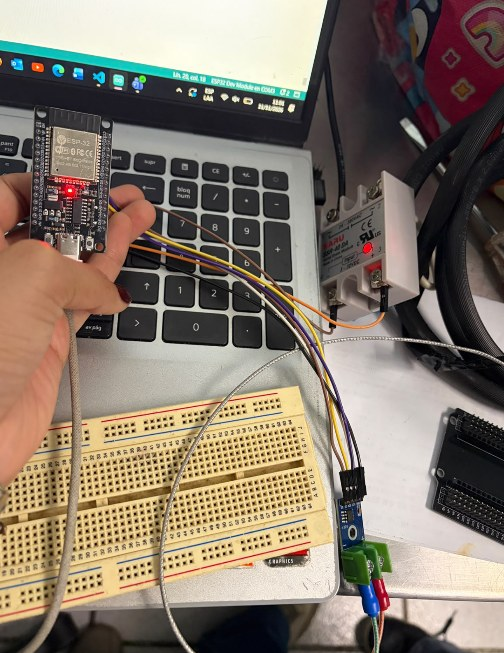
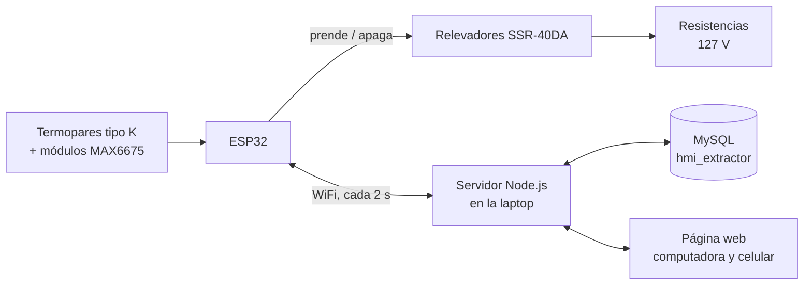
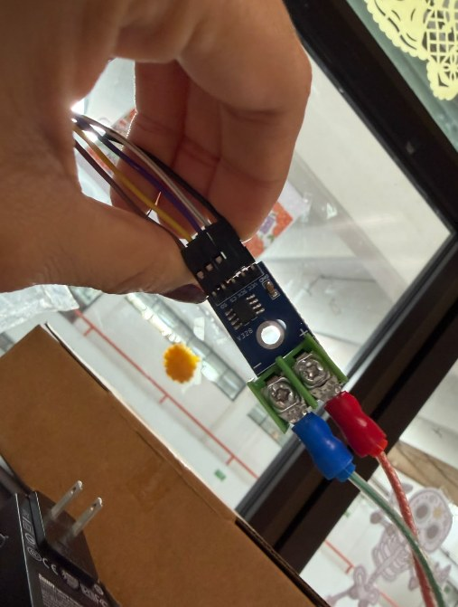
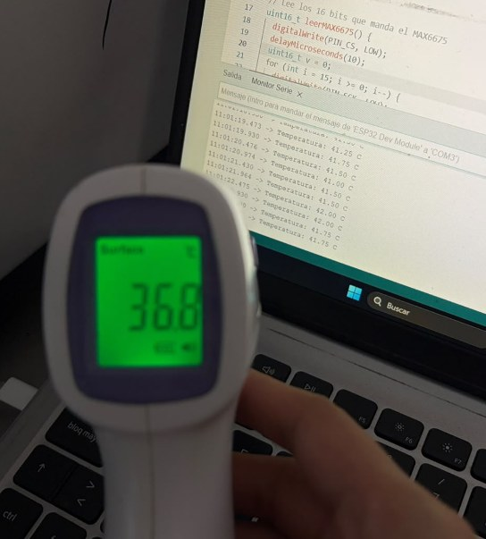

# Extractor de líquidos presurizados — control y monitoreo con ESP32

Sistema para **controlar la temperatura** de un extractor de líquidos presurizados (agua, H₂O) y **ver todo desde una página web**, tanto en la computadora como en el celular. Cada lectura y cada cambio que hace un operador queda guardado en una base de datos MySQL.

Proyecto desarrollado para la materia **Taller de Investigación 1** y como parte del **servicio social universitario** de la autora.
Autora: **Julia Isabel** ([@SnCjI](https://github.com/SnCjI))

*English version: [README.md](README.md)*

> **Estado actual (noviembre 2026):** la página, el servidor y la base de datos funcionan completos. En el equipo real ya se lee el termopar y el ESP32 ya maneja el relevador con el control PID. Falta la prueba de calentamiento con la resistencia conectada y afinar el control. El detalle está en [Objetivos cumplidos](#objetivos-cumplidos) y [Objetivos futuros](#objetivos-futuros).

| Celda de extracción | Termopar instalado | Prueba de ESP32 + relevador |
|---|---|---|
|  |  |  |

---

## Contenido

1. [Qué hace el proyecto](#qué-hace-el-proyecto)
2. [Cómo funciona](#cómo-funciona)
3. [Componentes](#componentes)
4. [Conexiones](#conexiones)
5. [La página web (HMI)](#la-página-web-hmi)
6. [Cómo ponerlo a funcionar](#cómo-ponerlo-a-funcionar)
7. [Objetivos cumplidos](#objetivos-cumplidos)
8. [En proceso](#en-proceso)
9. [Objetivos futuros](#objetivos-futuros)
10. [Seguridad](#seguridad)
11. [Estructura de carpetas](#estructura-de-carpetas)

---

## Qué hace el proyecto

La extracción con líquidos presurizados usa agua caliente a presión para sacar compuestos de una muestra. Para que el proceso salga bien y se pueda repetir, la temperatura tiene que mantenerse estable y hay que saber qué pasó en cada corrida.

Este proyecto resuelve tres cosas:

- **Controla la temperatura sola.** El operador escribe a cuántos grados quiere cada zona y el sistema calienta hasta llegar ahí y se mantiene.
- **Muestra el proceso en vivo.** Una página web enseña el equipo, las temperaturas, la potencia de cada resistencia y una gráfica. Se puede abrir en el celular.
- **Guarda la historia.** Todas las lecturas y todos los cambios (quién, cuándo y qué movió) quedan en MySQL y se pueden descargar para Excel.

El equipo tiene **2 zonas de calentamiento** (superior e inferior). Cada zona tiene una resistencia, un relevador que la prende y apaga, y un termopar que mide su temperatura.

---

## Cómo funciona



Explicado con palabras:

1. El **ESP32** lee la temperatura de cada zona una vez por segundo.
2. Con esa lectura, el **control PID** decide cuánta potencia darle a cada resistencia, de 0 a 100 %.
3. Cada 2 segundos el ESP32 le manda al **servidor** las temperaturas y la potencia. El servidor las guarda en **MySQL**.
4. En esa misma respuesta, el servidor le regresa al ESP32 los **ajustes** que el operador puso en la página (temperatura deseada y si el sistema está encendido).
5. La **página web** le pregunta al servidor cada segundo y muestra todo en vivo.

### Qué es el control PID

Antes el sistema solo prendía la resistencia cuando faltaba temperatura y la apagaba cuando sobraba. Eso hace que la temperatura suba y baje alrededor del valor deseado.

El PID es más fino: en lugar de "prendido o apagado", calcula **qué porcentaje de potencia** hace falta. Como el relevador solo sabe prender y apagar, se usa un truco: se prende **una fracción de cada ventana de 2 segundos**.

| Potencia que pide el PID | Lo que hace el relevador |
|---|---|
| 0 % | apagado |
| 25 % | 0.5 s prendido, 1.5 s apagado |
| 50 % | 1 s prendido, 1 s apagado |
| 100 % | prendido todo el tiempo |

Las tres letras del PID:

- **P (proporcional):** entre más lejos está del valor deseado, más potencia da.
- **I (integral):** corrige el error pequeño que queda con el tiempo, para llegar exacto.
- **D (derivativa):** frena cuando la temperatura sube muy rápido, para no pasarse.

### Red

El ESP32 crea su propia red WiFi, llamada `HMI-ESP32`. La laptop con el servidor y el celular se conectan a esa red, así que el sistema **no necesita internet**.

---

## Componentes

**Electrónica**

| Componente | Para qué sirve |
|---|---|
| ESP32 (Dev Module) | Cerebro del sistema: lee, controla y se comunica por WiFi |
| 2 termopares tipo K | Miden la temperatura de cada zona |
| 2 módulos MAX6675 | Convierten la señal del termopar en un dato que el ESP32 entiende |
| 2 relevadores de estado sólido SSR-40DA | Prenden y apagan las resistencias de 127 V con una señal de 3.3 V |
| 2 resistencias de calentamiento | Calientan cada zona de la celda |
| Fuente, regulador LM2596, fusible e interruptor | Alimentación y protección |

**Programas**

| Parte | Tecnología |
|---|---|
| Programa del ESP32 | Arduino (C++), librería ArduinoJson 7 |
| Servidor | Node.js + Express |
| Base de datos | MySQL 8 |
| Página web | HTML, CSS y JavaScript, con Chart.js para la gráfica |

---

## Conexiones

**Módulos MAX6675 → ESP32** (los dos comparten SCK y SO; cada uno tiene su propio CS)

| Pin del módulo | Zona 1 | Zona 2 |
|---|---|---|
| VCC | 3V3 | 3V3 |
| GND | GND | GND |
| SCK | GPIO 18 | GPIO 18 |
| SO | GPIO 19 | GPIO 19 |
| CS | GPIO 5 | GPIO 17 |

> El VCC va a **3V3, no a 5V**. Los pines del ESP32 no soportan 5 V.

**Relevadores SSR-40DA → ESP32** (lado de control)

| Terminal del SSR | Zona 1 | Zona 2 |
|---|---|---|
| 3 (+) | GPIO 25 | GPIO 26 |
| 4 (−) | GND | GND |

**Lado de 127 V:** el SSR va en serie con la **fase**, entre la clavija y la resistencia (terminales 1 y 2). El neutro va directo a la resistencia y la tierra al chasis metálico.



---

## La página web (HMI)

Tiene tres pestañas:

- **Inicio.** Diagrama animado del proceso (tanque de agua, bomba, extractor con sus 2 zonas, válvula y colector). Debajo, una tarjeta por zona con la temperatura, el ajuste, la potencia que está dando el PID y el botón para cambiar el ajuste. Arriba está el botón para encender o apagar todo el sistema.
- **Gráfica.** La temperatura de las dos zonas en el tiempo (últimos 5 minutos, 30 minutos, 2 horas o todo el día). La línea punteada es el ajuste y la franja de abajo muestra cuánta potencia tuvo cada resistencia.
- **Datos.** Una tabla tipo Excel con dos vistas: los **cambios y registros** (quién movió qué y a qué hora) y las **lecturas del proceso**. Se puede buscar, ordenar y descargar en CSV.

Detalles que vale la pena conocer:

- Para cambiar un ajuste o encender el sistema, la página **pide el nombre del operador**. Así cada cambio queda firmado en la bitácora.
- El ajuste permitido va de **0 a 100 °C**. **80 °C es el máximo recomendado**: si alguien pone más, la página pide confirmarlo y la bitácora lo marca.
- El botón **Ver en celular** muestra un código QR para abrir la página desde el teléfono.
- Cada zona tiene un botón **⚙ PID** para cambiar su `kp`, `ki` y `kd`. El ESP32 recibe los valores nuevos en unos 2 segundos, sin volver a subir el programa. La tarjeta muestra los valores actuales y **✓ en el ESP32** cuando el ESP32 confirma que ya los usa. Cada cambio queda en la bitácora con el nombre del operador.
- Si una zona todavía no está conectada (`ZONA_INSTALADA` en `false` dentro de `esp32_extractor.ino`), la página la muestra como **NO CONECTADA** en lugar de dar alarma.

---

## Cómo ponerlo a funcionar

### Lo que se necesita instalar

- [Node.js](https://nodejs.org) (versión 18 o más nueva)
- MySQL Server 8 y MySQL Workbench
- Arduino IDE con el paquete de placas **esp32** y la librería **ArduinoJson** (versión 7)

### Primera vez

1. Abrir una terminal en la carpeta `server` e instalar las dependencias:
   ```
   npm install
   ```
2. Crear la base de datos (pregunta el usuario y la contraseña de MySQL y los guarda en `server/db-config.json`):
   ```
   .\crear-base-de-datos.bat
   ```

### Uso diario

1. Encender el servidor desde la carpeta `server` y dejar esa ventana abierta:
   ```
   .\iniciar-servidor-mysql.bat
   ```
2. Elegir una de dos opciones:
   - **Sin el equipo:** en otra terminal, `.\simular-esp32.bat`. Es un ESP32 simulado que usa el mismo control PID, para probar la página.
   - **Con el equipo:** encender el ESP32 y conectar la laptop a la red `HMI-ESP32` con IP fija `192.168.4.2`.
3. Abrir `http://localhost:3000` en el navegador, o usar **Ver en celular**.
4. Presionar **Encender sistema** y usar **Ajuste** en cada zona.

### Programas del ESP32

Están en la carpeta `esp32`, del más sencillo al completo:

| Programa | Para qué sirve |
|---|---|
| `prueba_max6675` | Probar solo el termopar: muestra la temperatura en el Monitor Serie |
| `prueba_finalpid` | Probar el PID con una resistencia, sin WiFi. Se maneja con comandos (`sp 60`, `on`, `off`, `kp 4`, `ki 0.005`, `kd 40`) y se ve la curva en el Serial Plotter. También tiene modo manual (`pot 40`, `auto`) para la prueba de escalón |
| `esp32_extractor` | El programa completo: 2 zonas, PID, WiFi y comunicación con el servidor |

---

## Objetivos cumplidos

En el orden en que se fueron logrando:

**1. Anteproyecto.** Se redactó el documento del proyecto para Taller de Investigación 1.

**2. Primera versión de la página.** Un tablero de monitoreo que recibía datos de un ESP32 y los mostraba en indicadores y gráficas, con registro de operador.

**3. Base de datos en MySQL.** Se pasó de SQLite a MySQL. Se creó la base `hmi_extractor` con tres tablas: `readings` (lecturas), `operator_log` (bitácora) y `setpoints` (ajustes vigentes). El servidor crea y actualiza las tablas solo al arrancar.

**4. Acceso desde el celular.** La página se ve y se usa desde el teléfono en la misma red. Lo que se guarda desde el celular llega a la misma base de datos. Se agregó el código QR y la regla del firewall para el puerto 3000.

**5. Página del extractor con control real.** Se reemplazó el tablero ambiental por el diagrama animado del extractor, usando agua (H₂O) como fluido. La página dejó de ser solo para ver: desde ahí se enciende el sistema y se cambian los ajustes que el ESP32 obedece.

**6. Diseño final de 2 zonas y 3 pestañas.** A petición del equipo de trabajo, el extractor quedó con 2 resistencias y la página con las pestañas Inicio, Gráfica y Datos, conservando la descarga a CSV.

**7. Simulador del ESP32.** Un programa que se hace pasar por el equipo, para desarrollar y demostrar la página sin tener el hardware conectado.

**8. Lectura del termopar en el equipo real.** Se confirmó que los sensores son termopares tipo K con módulo MAX6675, se conectó uno al ESP32 y se obtuvo la temperatura en el Monitor Serie.

**9. Control PID.** Se cambió el control de prendido/apagado por un PID con salida de 0 a 100 %. Se probó con un modelo simulado del equipo: llegó al ajuste sin pasarse más de 0.5 °C y las protecciones respondieron (termopar desconectado y pérdida del servidor).

**10. El ESP32 maneja el relevador.** Con el programa `prueba_finalpid`, el ESP32 prende y hace parpadear el SSR según la potencia que calcula el PID. Esta prueba se hizo con la resistencia desconectada de la corriente.

**11. Primera comparación de la lectura.** Se comparó el termopar contra un termómetro infrarrojo: el termopar marcó cerca de 41.5 °C y el infrarrojo 36.8 °C.

**12. Herramientas para afinar el PID.** Un modo manual para la prueba de escalón (`pot 40`) y el programa `calcular-pid.js`, que calcula `kp`, `ki` y `kd` a partir de la respuesta medida del equipo.

**13. Control del PID desde la página.** El `kp`, `ki` y `kd` de cada zona se cambian desde la página web y se guardan en MySQL; el ESP32 los aplica al momento y avisa qué valores está usando.



---

## En proceso

- **Prueba de calentamiento con la resistencia conectada.** Es el siguiente paso: cerrar el ciclo completo (termopar → PID → SSR → resistencia) con un ajuste bajo y ver la curva.
- **Afinar el PID.** Los valores iniciales (`kp 4`, `ki 0.005`, `kd 40`) son conservadores: en simulación no se pasan del ajuste ni en una celda de acero pesada, pero pueden ser lentos. Los valores correctos para este equipo salen de una **prueba de escalón**:
  1. Con todo frío, en `prueba_finalpid` escribe `pot 40` (potencia fija de 40 %, sin PID) y deja calentar de 20 a 30 minutos sin pasar de 80 °C. Luego escribe `off`.
  2. Copia todo el Monitor Serie (con la marca de tiempo activada) a un archivo de texto, por ejemplo `escalon.txt`.
  3. En la carpeta `server` ejecuta `node calcular-pid.js escalon.txt`. Mide el retraso y la velocidad de calentamiento del equipo y da valores de `kp`, `ki` y `kd` recomendados, más suaves y más rápidos (método SIMC).
- **Revisar la diferencia de lectura.** Hay unos 5 °C entre el termopar y el termómetro infrarrojo. Puede deberse a que miden puntos distintos, o a que los infrarrojos leen de menos en metal brillante. Hay que compararlo contra una referencia confiable (por ejemplo, agua con hielo y agua hirviendo).

---

## Objetivos futuros

1. **Conectar la segunda zona** (segundo MAX6675 y segundo SSR) y probar las dos al mismo tiempo.
2. **Probar el programa completo** `esp32_extractor` en el ESP32 real, con WiFi y servidor. Hasta ahora se compiló y se probó contra un equipo simulado.
3. **Hacer una corrida de extracción completa** controlada y registrada desde la página.
4. **Calibrar los termopares** y, si hace falta, agregar una corrección en el programa.
5. **Agregar el sensor de presión.** La página y la base de datos ya tienen el espacio reservado; hoy muestran "sin sensor".
6. **Instalar la bomba** de alimentación, que en el diagrama aparece como opcional.
7. **Pasar el sistema a la computadora definitiva** del laboratorio, con su base de datos.
8. **Montar la electrónica en un gabinete**, con las protecciones físicas instaladas.
9. **Actualizar el anteproyecto** con los cambios: MySQL en lugar de SQLite, 2 zonas, agua como fluido y control PID.

---

## Seguridad

El programa tiene protecciones que el ESP32 aplica por su cuenta, aunque la página diga otra cosa:

- Al arrancar, las resistencias empiezan **apagadas**.
- Si pasan **15 segundos sin respuesta del servidor**, se apagan.
- Si un **termopar se desconecta o falla**, se apaga esa resistencia.
- Si una zona pasa de **105 °C**, se apaga esa resistencia.

Estas protecciones son de software y **no sustituyen una protección física**. El equipo trabaja con 127 V y con un recipiente a presión, así que se debe instalar un termostato o fusible térmico en serie con cada resistencia y una válvula de alivio. El cableado de 127 V se conecta y desconecta siempre con la clavija fuera.

**Antes de publicar o compartir el código:**

- El archivo `server/db-config.json` guarda la contraseña de MySQL. Está en `.gitignore` para que **no se suba a GitHub**.
- La contraseña de la red WiFi del ESP32 y la clave del dispositivo (`DEVICE_KEY`) están escritas en el código con valores de ejemplo. Conviene cambiarlas antes de usar el sistema fuera del laboratorio.

---

## Estructura de carpetas

```
hmi-dashboard/
├── README.md                  este documento en inglés
├── README.es.md               este documento
├── docs/
│   ├── img/                   fotos del equipo
│   └── notas-tecnicas.md      notas técnicas detalladas y documentación de versiones anteriores
├── esp32/
│   ├── prueba_max6675/        prueba del termopar
│   ├── prueba_finalpid/            prueba del PID con una resistencia
│   └── esp32_extractor/       programa completo (2 zonas, PID, WiFi)
├── server/
│   ├── server-mysql.js        servidor: recibe lecturas, guarda y entrega ajustes
│   ├── esquema-mysql.js       definición de las tablas
│   ├── simulador-esp32.js     ESP32 simulado para pruebas
│   ├── crear_base_hmi.sql     script para crear la base desde Workbench
│   └── *.bat                  accesos directos para Windows
├── public/                    la página web (HTML, CSS, JavaScript)
└── respaldo-v1…v3/            versiones anteriores del proyecto
```

### Versiones

| Versión | Qué cambió |
|---|---|
| v1 | Tablero de monitoreo ambiental (temperatura, presión, humedad) con SQLite |
| v2 | Página del extractor con 3 zonas, control desde la página y MySQL |
| v3 | 2 zonas, pestañas Inicio / Gráfica / Datos, control de prendido/apagado |
| v4 | Termopares tipo K con MAX6675 y control PID |
