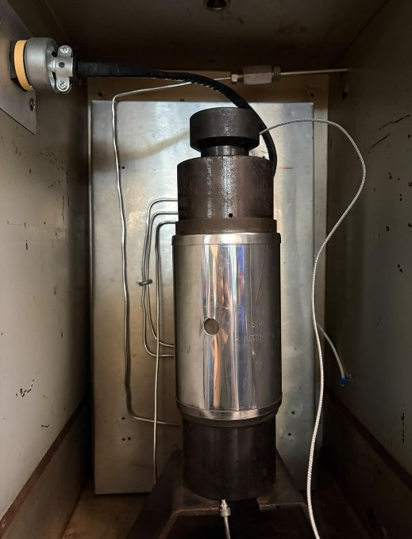
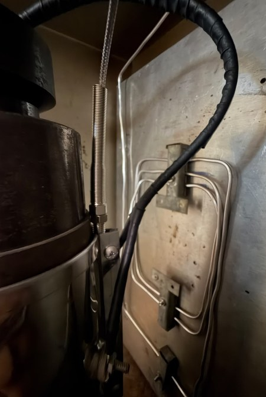
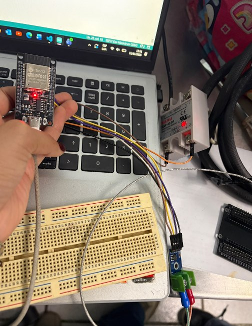
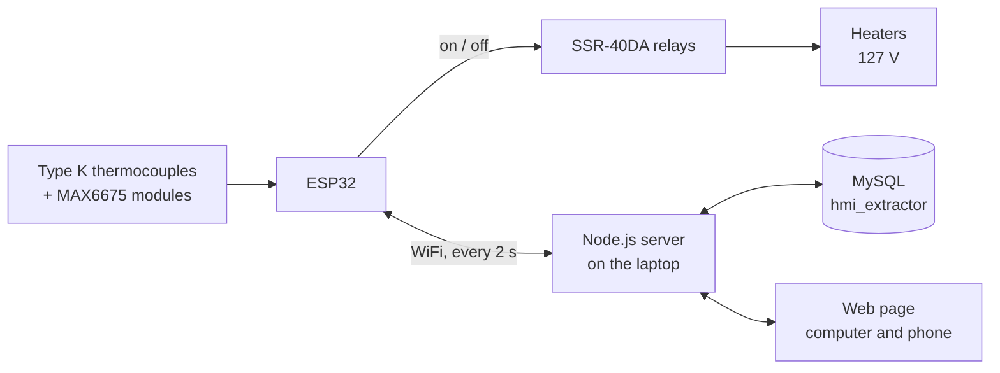
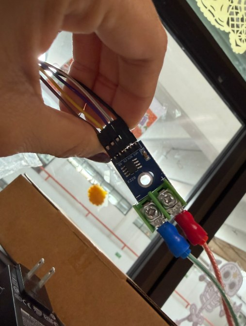
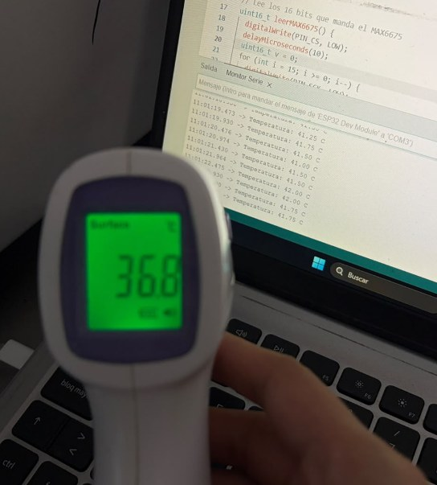

# Pressurized Liquid Extractor: ESP32 control and monitoring

A system that **controls the temperature** of a pressurized liquid extractor (water, H₂O) and lets you **watch and operate it from a web page**, on a computer or a phone. Every reading and every change an operator makes is stored in a MySQL database.

Project developed for the course **Taller de Investigación 1** (Research Workshop 1) and as part of the author's **university social service** (*servicio social*).
Author: **Julia Isabel** ([@SnCjI](https://github.com/SnCjI))

*Versión en español: [README.es.md](README.es.md)*

> **Current status (November 2026):** the web page, the server and the database are fully working. On the real equipment, the thermocouple is being read and the ESP32 already drives the relay with PID control. The heating test with the heater connected and the tuning of the controller are still pending. Details are in [Completed goals](#completed-goals) and [Future goals](#future-goals).

| Extraction cell | Thermocouple installed | ESP32 + relay test |
|---|---|---|
|  |  |  |

---

## Contents

1. [What the project does](#what-the-project-does)
2. [How it works](#how-it-works)
3. [Components](#components)
4. [Wiring](#wiring)
5. [The web page (HMI)](#the-web-page-hmi)
6. [Getting it running](#getting-it-running)
7. [Completed goals](#completed-goals)
8. [In progress](#in-progress)
9. [Future goals](#future-goals)
10. [Safety](#safety)
11. [Folder structure](#folder-structure)

---

## What the project does

Pressurized liquid extraction uses hot water under pressure to pull compounds out of a sample. For the process to work well and be repeatable, the temperature has to stay stable and you need a record of what happened in each run.

This project solves three things:

- **It controls the temperature on its own.** The operator types the temperature wanted for each zone, and the system heats up to that value and holds it.
- **It shows the process live.** A web page shows the equipment, the temperatures, the power going to each heater and a chart. It can be opened on a phone.
- **It keeps the history.** All readings and all changes (who, when and what was changed) are stored in MySQL and can be downloaded for Excel.

The equipment has **2 heating zones** (upper and lower). Each zone has a heater, a relay that switches it on and off, and a thermocouple that measures its temperature.

> Note: the web page, the code comments and the file names are in Spanish, because the system is used by a Spanish-speaking lab team.

---

## How it works



In plain words:

1. The **ESP32** reads the temperature of each zone once per second.
2. With that reading, the **PID controller** decides how much power to give each heater, from 0 to 100 %.
3. Every 2 seconds the ESP32 sends the temperatures and the power to the **server**, which saves them in **MySQL**.
4. In the same reply, the server sends back the **set-points** the operator entered on the page (target temperature and whether the system is on).
5. The **web page** asks the server every second and shows everything live.

### What PID control is

At first the system only switched the heater on when the temperature was too low and off when it was too high. That makes the temperature swing up and down around the target.

PID is finer: instead of "on or off", it works out **what percentage of power** is needed. Since the relay can only switch on and off, a trick is used: it is switched on for **a fraction of each 2-second window**.

| Power the PID asks for | What the relay does |
|---|---|
| 0 % | off |
| 25 % | 0.5 s on, 1.5 s off |
| 50 % | 1 s on, 1 s off |
| 100 % | on all the time |

The three letters of PID:

- **P (proportional):** the further the temperature is from the target, the more power it gives.
- **I (integral):** corrects the small error that remains over time, so it lands exactly on the target.
- **D (derivative):** slows things down when the temperature rises very fast, so it does not overshoot.

### Network

The ESP32 creates its own WiFi network, called `HMI-ESP32`. The laptop running the server and the phone both join that network, so the system **does not need internet**.

---

## Components

**Electronics**

| Component | What it is for |
|---|---|
| ESP32 (Dev Module) | Brain of the system: reads, controls and communicates over WiFi |
| 2 type K thermocouples | Measure the temperature of each zone |
| 2 MAX6675 modules | Turn the thermocouple signal into data the ESP32 can read |
| 2 SSR-40DA solid-state relays | Switch the 127 V heaters using a 3.3 V signal |
| 2 heaters | Heat each zone of the cell |
| Power supply, LM2596 regulator, fuse and switch | Power and protection |

**Software**

| Part | Technology |
|---|---|
| ESP32 program | Arduino (C++), ArduinoJson 7 library |
| Server | Node.js + Express |
| Database | MySQL 8 |
| Web page | HTML, CSS and JavaScript, with Chart.js for the chart |

---

## Wiring

**MAX6675 modules → ESP32** (both share SCK and SO; each one has its own CS)

| Module pin | Zone 1 | Zone 2 |
|---|---|---|
| VCC | 3V3 | 3V3 |
| GND | GND | GND |
| SCK | GPIO 18 | GPIO 18 |
| SO | GPIO 19 | GPIO 19 |
| CS | GPIO 5 | GPIO 17 |

> VCC goes to **3V3, not 5V**. The ESP32 pins cannot take 5 V.

**SSR-40DA relays → ESP32** (control side)

| SSR terminal | Zone 1 | Zone 2 |
|---|---|---|
| 3 (+) | GPIO 25 | GPIO 26 |
| 4 (−) | GND | GND |

**127 V side:** the SSR goes in series with the **live wire**, between the plug and the heater (terminals 1 and 2). Neutral goes straight to the heater and ground to the metal chassis.



---

## The web page (HMI)

It has three tabs:

- **Inicio (Home).** An animated diagram of the process (water tank, pump, extractor with its 2 zones, valve and collector). Below it, one card per zone with the temperature, the set-point, the power the PID is giving and the button to change the set-point. At the top is the button that turns the whole system on or off.
- **Gráfica (Chart).** The temperature of both zones over time (last 5 minutes, 30 minutes, 2 hours or the whole day). The dashed line is the set-point and the strip at the bottom shows how much power each heater had.
- **Datos (Data).** An Excel-style table with two views: **changes and records** (who changed what and at what time) and **process readings**. It can be searched, sorted and downloaded as CSV.

Things worth knowing:

- To change a set-point or turn the system on, the page **asks for the operator's name**. That way every change is signed in the logbook.
- The allowed set-point range is **0 to 100 °C**. **80 °C is the recommended maximum**: if someone enters more, the page asks for confirmation and the logbook flags it.
- The **Ver en celular** (View on phone) button shows a QR code to open the page from a phone.
- Each zone has a **⚙ PID** button to change its `kp`, `ki` and `kd`. The ESP32 picks up the new values in about 2 seconds, without uploading the program again. The card shows the current values and **✓ en el ESP32** once the ESP32 confirms it is using them. Every change is logged with the operator's name.
- If a zone is not wired yet (set `ZONA_INSTALADA` to `false` in `esp32_extractor.ino`), the page shows it as **NO CONECTADA** instead of raising an alarm.

---

## Getting it running

### What needs to be installed

- [Node.js](https://nodejs.org) (version 18 or newer)
- MySQL Server 8 and MySQL Workbench
- Arduino IDE with the **esp32** board package and the **ArduinoJson** library (version 7)

### First time

1. Open a terminal in the `server` folder and install the dependencies:
   ```
   npm install
   ```
2. Create the database (it asks for the MySQL user and password and saves them in `server/db-config.json`):
   ```
   .\crear-base-de-datos.bat
   ```

### Daily use

1. Start the server from the `server` folder and leave that window open:
   ```
   .\iniciar-servidor-mysql.bat
   ```
2. Pick one of two options:
   - **Without the equipment:** in another terminal, run `.\simular-esp32.bat`. It is a simulated ESP32 that uses the same PID controller, for testing the page.
   - **With the equipment:** power the ESP32 and connect the laptop to the `HMI-ESP32` network with the fixed IP `192.168.4.2`.
3. Open `http://localhost:3000` in the browser, or use **Ver en celular**.
4. Press **Encender sistema** (Turn system on) and use **Ajuste** (Set-point) on each zone.

### ESP32 programs

They are in the `esp32` folder, from the simplest to the complete one:

| Program | What it is for |
|---|---|
| `prueba_max6675` | Tests only the thermocouple: prints the temperature on the Serial Monitor |
| `prueba_finalpid` | Tests the PID with one heater, without WiFi. It is driven with commands (`sp 60`, `on`, `off`, `kp 4`, `ki 0.005`, `kd 40`) and the curve is shown in the Serial Plotter. It also has a manual mode (`pot 40`, `auto`) for the step test |
| `esp32_extractor` | The complete program: 2 zones, PID, WiFi and communication with the server |

---

## Completed goals

In the order they were achieved:

**1. Project proposal.** The project document for Taller de Investigación 1 was written.

**2. First version of the page.** A monitoring dashboard that received data from an ESP32 and showed it in gauges and charts, with an operator log.

**3. Database in MySQL.** The project moved from SQLite to MySQL. The `hmi_extractor` database was created with three tables: `readings`, `operator_log` (logbook) and `setpoints` (current set-points). The server creates and updates the tables by itself on startup.

**4. Access from the phone.** The page can be viewed and used from a phone on the same network. Whatever is saved from the phone reaches the same database. A QR code and a firewall rule for port 3000 were added.

**5. Extractor page with real control.** The environmental dashboard was replaced with the animated diagram of the extractor, using water (H₂O) as the fluid. The page stopped being view-only: the system is turned on from it, and the set-points the ESP32 follows are changed from it.

**6. Final design with 2 zones and 3 tabs.** At the team's request, the extractor was left with 2 heaters and the page with the Home, Chart and Data tabs, keeping the CSV download.

**7. ESP32 simulator.** A program that pretends to be the equipment, used to develop and demonstrate the page without the hardware connected.

**8. Thermocouple reading on the real equipment.** The sensors were confirmed to be type K thermocouples with MAX6675 modules. One was wired to the ESP32 and the temperature was read on the Serial Monitor.

**9. PID control.** The on/off control was replaced with a PID with a 0 to 100 % output. It was tested against a simulated model of the equipment: it reached the set-point without overshooting more than 0.5 °C, and the protections responded (thermocouple disconnected and server lost).

**10. The ESP32 drives the relay.** With the `prueba_finalpid` program, the ESP32 switches the SSR and makes it blink according to the power the PID calculates. This test was done with the heater unplugged from mains.

**11. First check of the reading.** The thermocouple was compared against an infrared thermometer: the thermocouple read about 41.5 °C and the infrared one 36.8 °C.

**12. PID tuning tools.** A manual mode for step tests (`pot 40`) and the `calcular-pid.js` script that computes `kp`, `ki` and `kd` from the measured response of the equipment.

**13. PID control from the page.** The `kp`, `ki` and `kd` of each zone are changed from the web page and stored in MySQL; the ESP32 applies them on the fly and reports back which values it is using.



---

## In progress

- **Heating test with the heater connected.** This is the next step: closing the full loop (thermocouple → PID → SSR → heater) with a low set-point and looking at the curve.
- **Tuning the PID.** The default values (`kp 4`, `ki 0.005`, `kd 40`) are conservative: in simulation they do not overshoot even on a heavy steel cell, but they may be slow. The right values for this equipment come from a **step test**:
  1. With everything cold, in `prueba_finalpid` type `pot 40` (fixed 40 % power, no PID) and let it heat for 20–30 minutes without going above 80 °C. Then type `off`.
  2. Copy the whole Serial Monitor (with timestamps on) into a text file, e.g. `escalon.txt`.
  3. In the `server` folder run `node calcular-pid.js escalon.txt`. It measures the delay and heating speed of the equipment and prints recommended, softer and faster `kp`, `ki`, `kd` values (SIMC method).
- **Checking the difference in readings.** There are about 5 °C between the thermocouple and the infrared thermometer. It may be because they measure different spots, or because infrared thermometers read low on shiny metal. It has to be compared against a reliable reference (for example, ice water and boiling water).

---

## Future goals

1. **Connect the second zone** (second MAX6675 and second SSR) and test both at the same time.
2. **Test the complete program** `esp32_extractor` on the real ESP32, with WiFi and the server. So far it has been compiled and tested against simulated equipment.
3. **Run a complete extraction** controlled and recorded from the page.
4. **Calibrate the thermocouples** and, if needed, add a correction in the program.
5. **Add the pressure sensor.** The page and the database already have a place reserved for it; today they show "sin sensor" (no sensor).
6. **Install the feed pump**, which appears as optional in the diagram.
7. **Move the system to the lab's final computer**, along with its database.
8. **Mount the electronics in an enclosure**, with the physical protections installed.
9. **Update the project proposal** with the changes: MySQL instead of SQLite, 2 zones, water as the fluid and PID control.

---

## Safety

The program has protections that the ESP32 applies on its own, even if the page says otherwise:

- On startup, the heaters begin **off**.
- If **15 seconds pass with no reply from the server**, they switch off.
- If a **thermocouple is disconnected or fails**, that heater switches off.
- If a zone goes above **105 °C**, that heater switches off.

These are software protections and **do not replace physical protection**. The equipment works with 127 V and a pressurized vessel, so a thermostat or thermal fuse must be installed in series with each heater, plus a relief valve. The 127 V wiring is always connected and disconnected with the plug out.

**Before publishing or sharing the code:**

- The file `server/db-config.json` stores the MySQL password. It is listed in `.gitignore` so it is **not uploaded to GitHub**.
- The ESP32 WiFi password and the device key (`DEVICE_KEY`) are written in the code with example values. They should be changed before using the system outside the lab.

---

## Folder structure

```
hmi-dashboard/
├── README.md                  this document
├── README.es.md               this document in Spanish
├── docs/
│   ├── img/                   photos of the equipment
│   └── notas-tecnicas.md      detailed technical notes and documentation of earlier versions (Spanish)
├── esp32/
│   ├── prueba_max6675/        thermocouple test
│   ├── prueba_finalpid/            PID test with one heater
│   └── esp32_extractor/       complete program (2 zones, PID, WiFi)
├── server/
│   ├── server-mysql.js        server: receives readings, stores and serves set-points
│   ├── esquema-mysql.js       table definitions
│   ├── simulador-esp32.js     simulated ESP32 for testing
│   ├── crear_base_hmi.sql     script to create the database from Workbench
│   └── *.bat                  Windows shortcuts
├── public/                    the web page (HTML, CSS, JavaScript)
└── respaldo-v1…v3/            earlier versions of the project
```

### Versions

| Version | What changed |
|---|---|
| v1 | Environmental monitoring dashboard (temperature, pressure, humidity) with SQLite |
| v2 | Extractor page with 3 zones, control from the page and MySQL |
| v3 | 2 zones, Home / Chart / Data tabs, on/off control |
| v4 | Type K thermocouples with MAX6675 and PID control |
